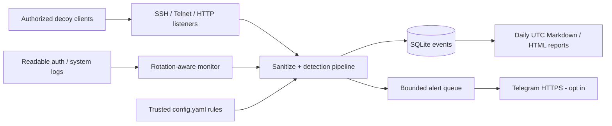
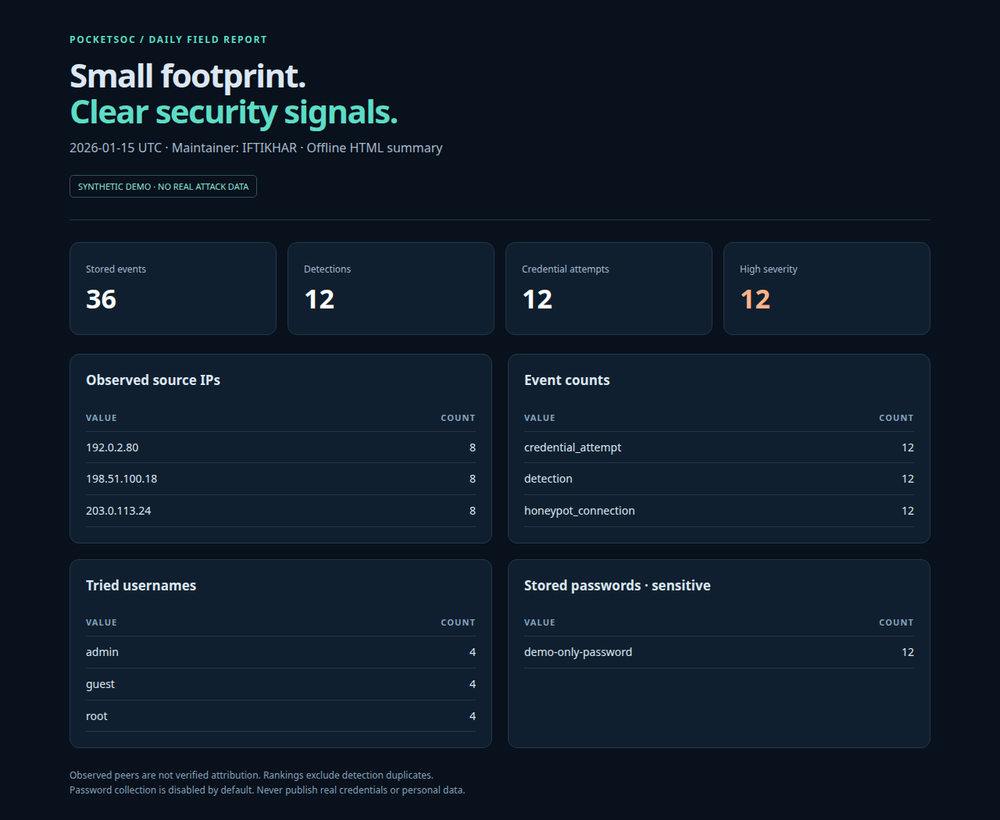

# PocketSOC

**A small SOC lab that fits in your pocket.** Lightweight Python collection, detection, Telegram alerting, and daily summaries for Android Termux and Linux.

**Maintainer: IFTIKHAR** · Python 3.10+ · MIT · Defensive, authorized labs only

[](https://github.com/specter-sec/pocketsoc/actions/workflows/ci.yml)

PocketSOC turns a spare Android device into a learning-sized monitoring node. It accepts decoy connections on three high ports, watches log files you can read, applies YAML rules, and keeps a local SQLite audit trail. It is **not** an enterprise SIEM, malware sandbox, production SSH server, or security certification.

## What ships

| Module | Capability |
| --- | --- |
| `honeypot.py` | SSH password authentication capture via AsyncSSH, minimal Telnet-style prompts, and HTTP Basic/form login capture. All logins are rejected; no shell or command execution. |
| `detectors.py` | Failed-login patterns, per-source sliding-window brute-force detection, low/medium/high YAML rules, and log rotation/truncation handling. |
| `alerts.py` | Opt-in Telegram notifications, per-source/rule deduplication, a global request rate cap, bounded queue, timeouts, and 429 backoff. No passwords are sent. |
| `storage.py` | SQLite `events` table, indexed UTC timestamps, restricted file permissions, and configurable retention. |
| `reports.py` | Daily Markdown and optional standalone HTML: event counts, top observed IPs, tried usernames, and opt-in stored passwords. |

**Safe defaults:** loopback-only listeners; ports `2222`, `2323`, `8080`; password fields redacted; Telegram off; raw log copying off; no GeoIP/reputation requests or telemetry. ATT&CK `T1110.001` mappings are included as learning labels, not attribution.

## Architecture



No inbound connection is proxied. No submitted command is executed. Detection runs locally; the only optional outbound traffic is Telegram HTTPS.

## Install on Termux

Install Termux from a source listed in the [official Termux project](https://github.com/termux/termux-app), and keep its app/plugins from the same source. Keep this project in Termux's private `$HOME`, **not shared Android storage**.

```sh
pkg update
pkg install git
cd "$HOME"
git clone https://github.com/specter-sec/pocketsoc.git
cd pocketsoc
sh install.sh
. .venv/bin/activate
pocketsoc check
pocketsoc run
```

The installer uses Termux's [prebuilt `python-cryptography` package](https://github.com/termux/termux-packages/tree/master/packages/python-cryptography) through a system-site-packages virtual environment, avoiding a needless Rust build. If a YAML build needs native tools on your device, install `clang make libyaml` and retry. Do **not** replace Termux's managed `pip` with `pip install --upgrade pip`.

Linux development setup:

```sh
python3 -m venv .venv
. .venv/bin/activate
python -m pip install -e '.[dev]'
pocketsoc check
pocketsoc run
```

**Validation scope:** the automated suite targets Linux and Python 3.10/3.12. The Termux script and Android background behavior need testing on your own device; this repository does not claim a physical Android-device test.

## Use in an isolated lab

Default listeners bind to `127.0.0.1`, so only local clients can reach them. Test with **dummy credentials only**:

```sh
# In another terminal; a rejected login is the expected outcome.
ssh -p 2222 demo@127.0.0.1
# Telnet-like text prompts (netcat is optional):
nc 127.0.0.1 2323
# HTTP Basic attempt, using a deliberately fake password:
curl -u demo:demo-only-password http://127.0.0.1:8080/
```

SSH uses an ephemeral in-memory host key, so its fingerprint changes after restart. Use a dedicated lab client/known-hosts file rather than weakening your normal SSH client's trust settings. The Telnet listener is a minimal text decoy, not a complete Telnet implementation; HTTP supports Basic Auth and URL-encoded POST fields, not TLS or arbitrary login schemes.

To monitor an **authorized private network**, deliberately change a listener's numeric `host` in `config.yaml`, then run `pocketsoc run --allow-network`. Without this flag, non-loopback binds are refused. Do not port-forward a personal phone or expose it to the internet as a production sensor.

## Monitor auth/system logs

Add paths to files you own or are explicitly permitted to read:

```yaml
monitor:
  paths: [~/lab-auth.log]
  start_at_end: true
  store_all_lines: false
  poll_seconds: 1
```

Termux does not automatically have access to Android's system logs, other apps' files, or Linux `/var/log/auth.log`. On an unrooted phone, use your own application's/sshd's log file or a copied lab log. Missing/inaccessible paths are skipped so listeners can continue. Existing files start at EOF by default; use `start_at_end: false` only when you intend to ingest old records. New rotated files are read from the beginning; incomplete lines wait for a newline. Very long lines are dropped.

A safe synthetic line to append is:

```text
Jan 15 10:00:00 lab sshd[123]: Failed password for demo from 203.0.113.24 port 4444 ssh2
```

IP extraction supports common `from IP`, `rhost=IP`, and IPv4 log forms. Unknown sources are grouped by log file, so brute-force correlation without an IP is less precise.

## Configure detection rules

Rules live in `config.yaml`; no Python plugin or shell command is evaluated.

```yaml
- id: brute_force
  description: Possible brute force in a lab auth log
  kinds: [log_line]
  pattern: 'failed password|authentication failure|invalid user|login failed'
  severity: high
  threshold: 5
  window_seconds: 120
  mitre: T1110.001
```

`field` can be `message` (default) or `kind`. `kinds` narrows a rule's input. A threshold above one emits at most one detection per source/rule/window; threshold one records each matching event. Correlation state is bounded to 4,096 source/rule keys. **Rules are trusted operator input:** regexes are length-limited but have no hard execution-time sandbox; avoid expensive patterns and never load unreviewed YAML. Review detections as hypotheses, not proof of compromise.

## Telegram alerts — opt in

```sh
cp -n .env.example .env
chmod 600 .env
# Edit .env locally, never in a public issue or commit.
```

Set `TELEGRAM_BOT_TOKEN` and `TELEGRAM_CHAT_ID`, start a chat with your own bot, then enable `telegram.enabled: true` in YAML. Process environment values take precedence over `.env`. No saved/personal token is bundled or used by the project.

The sender uses Telegram's official [`sendMessage` API](https://core.telegram.org/bots/api#sendmessage). Defaults allow at most 10 requests/minute, suppress the same source/rule/port for 300 seconds, and send only medium/high detections. Requests time out after five seconds; failed requests also count toward the cap. A full queue or network failure never deletes the stored event. Deduplication/rate-limit state is in memory and resets on restart. Alerts contain rule, severity, observed IP/port, timestamp, and ATT&CK ID—**not passwords, usernames, raw logs, or request bodies**.

## Daily reports and screenshots

While running, PocketSOC writes the previous UTC day's report shortly after midnight (checked once per minute). On graceful shutdown it also writes the current day's partial summary. To regenerate any retained day:

```sh
pocketsoc report --date "$(date -u +%F)" --html
# Offline demo: no listeners, no Telegram, no real data.
pocketsoc demo --output-dir reports/demo
```



*Actual browser screenshot of `pocketsoc demo` output, rendered on Linux—not a simulated Android screen. The IPs are documentation ranges and all credentials are fictional. Reproduce with `pocketsoc demo`, then open the generated HTML locally.*

Rankings exclude detection rows to avoid counting the same underlying attempt twice. Observed peer IPs can be proxies/NATs and do not identify a person. `privacy.capture_passwords` is **false** by default; if explicitly enabled for an authorized decoy, plaintext attempted passwords can appear in the database and reports. Keep these artifacts private and delete them promptly. This option does not scrub arbitrary raw log text; keep `store_all_lines: false` unless you have reviewed that data.

## Run without systemd

```sh
sh scripts/background.sh
# It prints the exact PID and graceful stop command:
kill -TERM <printed-pid>
```

The runner uses `nohup`; the app locks its data directory to prevent duplicate instances. Logs are in `data/background.log` and rotating `data/pocketsoc.log`. Database/reports are created with restrictive permissions. The database retains 14 days by default; check disk use and rotate the background log yourself.

Android can still stop background processes. The [official Termux README](https://github.com/termux/termux-app#installation) documents Android 12+ process limits. Battery settings and an optional `termux-wake-lock` may help during an attended lab, but consume battery and do not guarantee uptime; release it with `termux-wake-unlock` afterward. This is not a replacement for a reliably hosted production sensor.

## Threat model

- **Protect:** the operator's device, bot token, source logs, captured data, and storage budget.
- **Assume hostile:** every network byte and submitted username/password. Inputs are bounded, connections time out, concurrency is capped, output is escaped, and credentials never grant access.
- **Trust:** the local operator, reviewed YAML rules, Python dependencies, and the host OS. Run as an ordinary Termux/Linux user, not root.
- **Out of scope:** kernel or dependency exploits, a full protocol implementation for Telnet/HTTP, distributed high-volume DoS, reliable attacker attribution, persistence after Android kills the process, and enterprise incident response. Limits are a learning-sized safety net, not DoS protection. SQLite and reports are not encrypted at rest.

Do not store production passwords, mix this decoy with real services, or treat a quiet report as evidence of safety. See [SECURITY.md](SECURITY.md).

## Development

```sh
python -m pip install -e '.[dev]'
pytest -q
ruff check .
python -m build
```

CI runs tests and lint on Python 3.10/3.12 with least-privilege permissions and SHA-pinned GitHub Actions. Tests use local loopback sockets, temporary databases, synthetic logs, and mocked Telegram transport; they do not contact real targets or send bot messages.

Project layout: `pocketsoc/` contains the modular pipeline; `tests/` contains regression/integration tests; `scripts/` has the background runner; `config.yaml` is the documented example; `.env.example` is the blank secret template. See [CONTRIBUTING.md](CONTRIBUTING.md) and [CHANGELOG.md](CHANGELOG.md).

## Legal and ethical use

Use PocketSOC **only on devices, log files, and networks you own or have explicit permission to monitor**. Honeypots and credential collection can be subject to privacy, consent, retention, and computer-misuse laws. Obtain authorization, use isolated lab accounts and dummy data, and follow applicable law. Do not use it for credential theft, impersonation, unauthorized surveillance, or offensive access. IFTIKHAR provides this educational software without warranty under the [MIT license](LICENSE).
